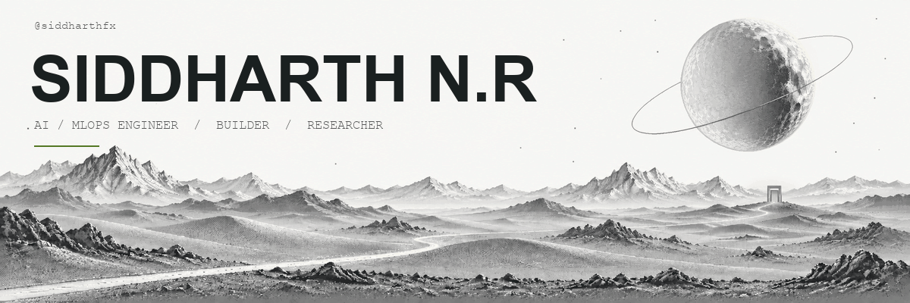
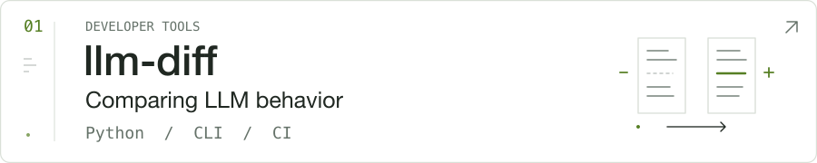
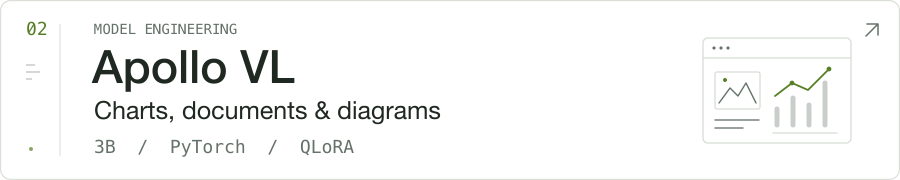
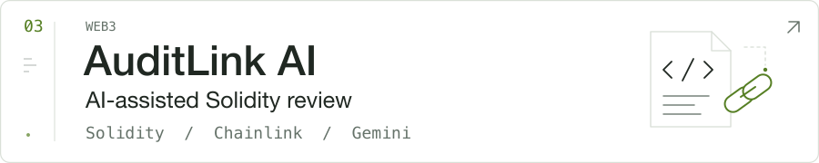

<!-- Personal profile for SiddharthFX. Upload README.md and assets/ together. -->

<picture>
  <source media="(prefers-color-scheme: dark)" srcset="assets/orbit/hero-dark.gif">
  <source media="(prefers-color-scheme: light)" srcset="assets/orbit/hero-light.gif">
  
</picture>

  <b>Models, tools, and the software around them.</b> 
  I’m an AI/MLOps engineer from Tamil Nadu, India. 
  I train compact models, build developer tools, and ship full-stack applications.

Currently researching LLM verification at <b>Crebiliti</b>.

<a href="https://siddharth16.space/"><picture>
  <source media="(prefers-color-scheme: dark)" srcset="assets/icons/portfolio-dark.svg">
  <source media="(prefers-color-scheme: light)" srcset="assets/icons/portfolio-light.svg">
  
</picture></a> &nbsp;
<a href="https://github.com/SiddharthFX"><picture>
  <source media="(prefers-color-scheme: dark)" srcset="assets/icons/github-dark.svg">
  <source media="(prefers-color-scheme: light)" srcset="assets/icons/github-light.svg">
  
</picture></a> &nbsp;
<a href="https://www.linkedin.com/in/siddharth-n-r-842529356"><picture>
  <source media="(prefers-color-scheme: dark)" srcset="assets/icons/linkedin-dark.svg">
  <source media="(prefers-color-scheme: light)" srcset="assets/icons/linkedin-light.svg">
  
</picture></a> &nbsp;
<a href="mailto:siddhufx7@gmail.com"><picture>
  <source media="(prefers-color-scheme: dark)" srcset="assets/icons/gmail-dark.svg">
  <source media="(prefers-color-scheme: light)" srcset="assets/icons/gmail-light.svg">
  
</picture></a>

<a href="https://siddharth16.space/">Portfolio</a> &nbsp; / &nbsp; <a href="https://github.com/SiddharthFX">GitHub</a> &nbsp; / &nbsp; <a href="https://www.linkedin.com/in/siddharth-n-r-842529356">LinkedIn</a> &nbsp; / &nbsp; <a href="mailto:siddhufx7@gmail.com">Email</a>

 

<h3 align="center">01 &nbsp; / &nbsp; Tech stack</h3>

<b>MODELS & INFERENCE</b>

<picture>
  <source media="(prefers-color-scheme: dark)" srcset="assets/icons/python-dark.svg">
  <source media="(prefers-color-scheme: light)" srcset="assets/icons/python-light.svg">
  
</picture> &nbsp;
<picture>
  <source media="(prefers-color-scheme: dark)" srcset="assets/icons/pytorch-dark.svg">
  <source media="(prefers-color-scheme: light)" srcset="assets/icons/pytorch-light.svg">
  
</picture> &nbsp;
<picture>
  <source media="(prefers-color-scheme: dark)" srcset="assets/icons/huggingface-dark.svg">
  <source media="(prefers-color-scheme: light)" srcset="assets/icons/huggingface-light.svg">
  
</picture> &nbsp;
<picture>
  <source media="(prefers-color-scheme: dark)" srcset="assets/icons/scikitlearn-dark.svg">
  <source media="(prefers-color-scheme: light)" srcset="assets/icons/scikitlearn-light.svg">
  
</picture> &nbsp;
<picture>
  <source media="(prefers-color-scheme: dark)" srcset="assets/icons/ollama-dark.svg">
  <source media="(prefers-color-scheme: light)" srcset="assets/icons/ollama-light.svg">
  
</picture>
 Python &nbsp;·&nbsp; PyTorch &nbsp;·&nbsp; Hugging Face &nbsp;·&nbsp; scikit-learn &nbsp;·&nbsp; Ollama

<b>WEB & APIS</b>

<picture>
  <source media="(prefers-color-scheme: dark)" srcset="assets/icons/typescript-dark.svg">
  <source media="(prefers-color-scheme: light)" srcset="assets/icons/typescript-light.svg">
  
</picture> &nbsp;
<picture>
  <source media="(prefers-color-scheme: dark)" srcset="assets/icons/react-dark.svg">
  <source media="(prefers-color-scheme: light)" srcset="assets/icons/react-light.svg">
  
</picture> &nbsp;
<picture>
  <source media="(prefers-color-scheme: dark)" srcset="assets/icons/nodejs-dark.svg">
  <source media="(prefers-color-scheme: light)" srcset="assets/icons/nodejs-light.svg">
  
</picture> &nbsp;
<picture>
  <source media="(prefers-color-scheme: dark)" srcset="assets/icons/fastapi-dark.svg">
  <source media="(prefers-color-scheme: light)" srcset="assets/icons/fastapi-light.svg">
  
</picture>
 TypeScript &nbsp;·&nbsp; React &nbsp;·&nbsp; Node.js &nbsp;·&nbsp; FastAPI

<b>CLOUD & DELIVERY</b>

<picture>
  <source media="(prefers-color-scheme: dark)" srcset="assets/icons/docker-dark.svg">
  <source media="(prefers-color-scheme: light)" srcset="assets/icons/docker-light.svg">
  
</picture> &nbsp;
<picture>
  <source media="(prefers-color-scheme: dark)" srcset="assets/icons/googlecloud-dark.svg">
  <source media="(prefers-color-scheme: light)" srcset="assets/icons/googlecloud-light.svg">
  
</picture> &nbsp;
<picture>
  <source media="(prefers-color-scheme: dark)" srcset="assets/icons/githubactions-dark.svg">
  <source media="(prefers-color-scheme: light)" srcset="assets/icons/githubactions-light.svg">
  
</picture> &nbsp;
<picture>
  <source media="(prefers-color-scheme: dark)" srcset="assets/icons/git-dark.svg">
  <source media="(prefers-color-scheme: light)" srcset="assets/icons/git-light.svg">
  
</picture>
 Docker &nbsp;·&nbsp; Google Cloud &nbsp;·&nbsp; GitHub Actions &nbsp;·&nbsp; Git

<b>DATA & WEB3</b>

<picture>
  <source media="(prefers-color-scheme: dark)" srcset="assets/icons/mongodb-dark.svg">
  <source media="(prefers-color-scheme: light)" srcset="assets/icons/mongodb-light.svg">
  
</picture> &nbsp;
<picture>
  <source media="(prefers-color-scheme: dark)" srcset="assets/icons/supabase-dark.svg">
  <source media="(prefers-color-scheme: light)" srcset="assets/icons/supabase-light.svg">
  
</picture> &nbsp;
<picture>
  <source media="(prefers-color-scheme: dark)" srcset="assets/icons/solidity-dark.svg">
  <source media="(prefers-color-scheme: light)" srcset="assets/icons/solidity-light.svg">
  
</picture>
 MongoDB &nbsp;·&nbsp; Supabase &nbsp;·&nbsp; Solidity

Also working with <b>QLoRA / PEFT</b>, <b>DDP</b>, <b>MLX</b>, and <b>llama.cpp / GGUF</b>.

 

<h3 align="center">02 &nbsp; / &nbsp; Selected builds</h3>

<a href="https://github.com/Pluto-AI-Labs/llm-diff">
<picture>
  <source media="(prefers-color-scheme: dark)" srcset="assets/projects/llm-diff-dark.svg">
  <source media="(prefers-color-scheme: light)" srcset="assets/projects/llm-diff-light.svg">
  
</picture>
</a>

<a href="https://huggingface.co/Pluto-AI-Labs/Apollo-VL-Edge-3B">
<picture>
  <source media="(prefers-color-scheme: dark)" srcset="assets/projects/apollo-vl-dark.svg">
  <source media="(prefers-color-scheme: light)" srcset="assets/projects/apollo-vl-light.svg">
  
</picture>
</a>

<a href="https://github.com/SiddharthFX/Auditlink-public">
<picture>
  <source media="(prefers-color-scheme: dark)" srcset="assets/projects/auditlink-ai-dark.svg">
  <source media="(prefers-color-scheme: light)" srcset="assets/projects/auditlink-ai-light.svg">
  
</picture>
</a>

<a href="https://github.com/SiddharthFX?tab=repositories">Explore my repositories ↗</a>

 

<b>More projects & experiments</b>

- **[Atlas Coder](https://huggingface.co/Pluto-AI-Labs/Atlas-Coder-2-0.5B)** — a compact coding model for local inference.
- **[Crypfolio](https://github.com/SiddharthFX/crypfolio)** — a browser-only crypto tracker with live market data and local storage.
- **[AnvilX](https://github.com/SiddharthFX/anvilx-dashboard)** — a macOS and web platform with authentication and on-chain functionality.
- **[MedASK AI](https://github.com/SiddharthFX/medask-AI)** — prescription OCR with Google Cloud Vision and Gemini, deployed on Cloud Run.

Also building **Pluto Notebook**, an offline AI workspace for developers.

<b>Research & a little background</b>

At **Crebiliti**, I work on evidence verification for LLMs, including NLI, embedding-based relation scoring, LLM-as-judge evaluation, and synthetic-data validation.

I founded [Pluto AI Labs](https://huggingface.co/Pluto-AI-Labs), where I release open models and datasets. Previously, I worked in ML engineering at **Igress Solutions** and blockchain development at **Codec Technologies** and **MegaBliss Worldwide**.

**B.Tech, Artificial Intelligence & Data Science** — Ramco Institute of Technology.

- **[Pluto-Genesis paper](https://doi.org/10.5281/zenodo.21368749)** — QLoRA fine-tuning on ephemeral compute with cross-session checkpoint recovery. Zenodo preprint.
- **[Athena Brain](https://huggingface.co/datasets/Pluto-AI-Labs/Athena-1.0-Brain)** — a vision-language dataset for document and chart understanding.

 

---

Always building. Always learning. <a href="https://siddharth16.space/">siddharth16.space</a> &nbsp; · &nbsp; <a href="mailto:siddhufx7@gmail.com">Let’s talk ↗</a> &nbsp; · &nbsp; <a href="README-static.md">Still version</a>

